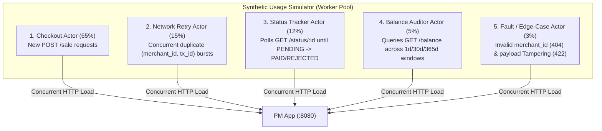
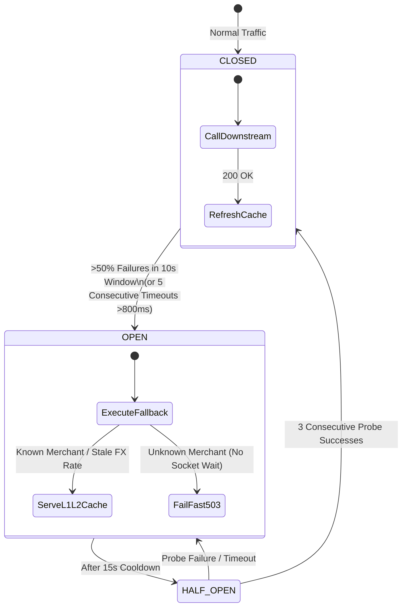
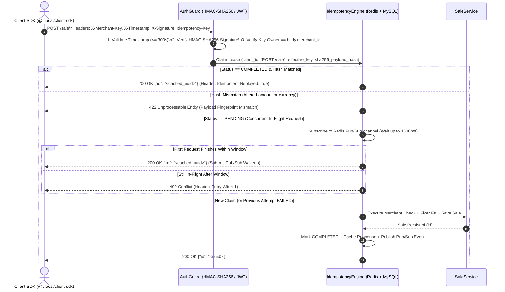
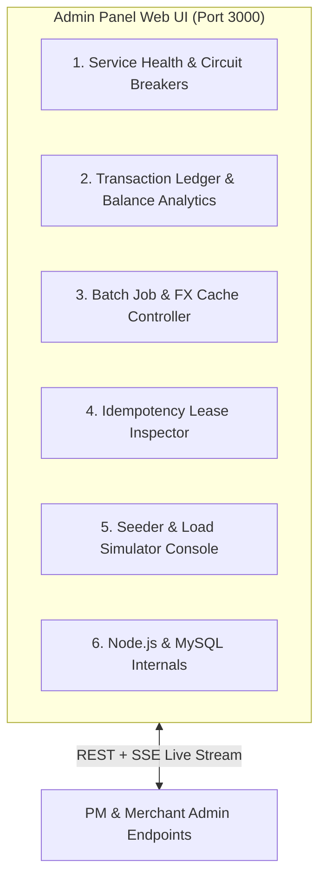

# NestJS (Node.js / TypeScript) Implementation Plan & Extended Architecture Report

This report defines a clean-slate **Node.js, TypeScript, and NestJS** solution for the **2018/05/17 Technical Challenge Specification**, structured in two parts:
1. **Part 1 (Baseline Solution):** Direct, lean implementation of the exact problem specification (Merchant app, PM app, 30s Fixer.io rate limit, `(merchant_id, transaction_id)` idempotency, 30s 70/30 batch clearing job, tests, and startup script).
2. **Parts 2–6 (Beyond the Specification):** Five production-grade engineering extensions that evolve the baseline challenge into a high-throughput payment gateway platform.

---

## Part 1: Baseline NestJS Solution (Strict 2018/05/17 Specification)

### 1.1 Requirements-to-Stack Mapping

The original prompt specifies Java 8, Spring 5, MySQL 5.x, Maven, and Embedded Jetty. Translating those constraints directly to a modern Node.js / TypeScript stack:

| Original Specification | Baseline NestJS Solution | Rationale |
| :--- | :--- | :--- |
| **Java 8 + Spring 5** | **Node.js 22 LTS + TypeScript 5.x + NestJS 11** | Provides dependency injection, modular controllers/services, validation pipes, and lifecycle hooks analogous to Spring. |
| **Maven (2 Projects / ZIP)** | **`pnpm` Workspace Monorepo (`apps/merchant`, `apps/pm`)** | Manages both applications, shared DTOs, and test suites under a single dependency tree with unified build/start scripts. |
| **Embedded Jetty** | **Fastify Adapter (`@nestjs/platform-fastify`)** | Replaces the default Express adapter (just as Jetty replaces default Tomcat in Spring) for lower overhead and faster JSON serialization. |
| **MySQL 5.x / 8.x** | **MySQL + TypeORM (or MikroORM) + `mysql2`** | Relational persistence for `merchants` and `sales` tables with strict unique constraints and ACID transactions. |
| **Batch Process (Every 30s)** | **`@nestjs/schedule` (`@Interval(30_000)`)** | Native in-process scheduler inside the PM application that transitions `PENDING` sales (`70% PAID`, `30% REJECTED`). |
| **Automated Tests** | **Vitest / Jest + Supertest** | Unit tests for business rules (FX conversion, 70/30 batch logic) and E2E HTTP tests for both applications. |
| **Deliverables** | **`start-all.ps1` / `docker-compose.yml` + `README.md`** | Single-command startup script for both applications plus MySQL, and architectural documentation. |

---

### 1.2 Baseline System Architecture

```mermaid
flowchart LR
    Client["Client / Consumer"]

    subgraph PM_App["Application 2: PM (Port 8080)"]
        SaleCtrl["POST /sale\nGET /status/:id\nGET /balance"]
        SaleSvc["SaleService"]
        FixerSvc["FixerService\n(30s In-Memory Cache)"]
        BatchJob["BatchClearingJob\n(@Interval 30s: 70% PAID / 30% REJECTED)"]
        SaleCtrl --> SaleSvc
        SaleSvc --> FixerSvc
    end

    subgraph Merchant_App["Application 1: Merchant (Port 8081)"]
        MerchCtrl["GET /check/:merchant_id"]
    end

    DB[("MySQL Database\n- merchants\n- sales")]
    FixerAPI["External API\nhttp://fixer.io"]

    Client -->|REST JSON| SaleCtrl
    Client -->|REST| MerchCtrl
    SaleSvc -->|1. Validate merchant_id\nGET /check/:id| MerchCtrl
    FixerSvc -->|2. Fetch FX rates\n(Max 1 call / 30s)| FixerAPI
    MerchCtrl -->|SELECT by id| DB
    SaleSvc -->|INSERT / SELECT / SUM| DB
    BatchJob -->|UPDATE status WHERE PENDING| DB
```

---

### 1.3 Baseline Database Schema

In the baseline solution, only two tables are required. Notice that the specification defines `merchant_id` and `transaction_id` as `String` in the JSON contracts:

```sql
CREATE TABLE merchants (
  id VARCHAR(64) NOT NULL,
  name VARCHAR(120) NOT NULL,
  PRIMARY KEY (id)
) ENGINE=InnoDB DEFAULT CHARSET=utf8mb4;

CREATE TABLE sales (
  id VARCHAR(36) NOT NULL,                  -- Autogenerated platform-unique UUID
  merchant_id VARCHAR(64) NOT NULL,
  transaction_id VARCHAR(128) NOT NULL,
  currency CHAR(3) NOT NULL,
  amount_original DECIMAL(18, 2) NOT NULL,
  amount_usd DECIMAL(18, 2) NOT NULL,       -- Always persisted in USD
  status ENUM('PENDING', 'PAID', 'REJECTED') NOT NULL DEFAULT 'PENDING',
  created_at DATETIME NOT NULL DEFAULT CURRENT_TIMESTAMP,
  PRIMARY KEY (id),
  -- Enforces baseline idempotency on the (merchant_id, transaction_id) tuple:
  UNIQUE KEY uk_sales_merchant_tx (merchant_id, transaction_id),
  -- Optimizes GET /balance date-range aggregation per merchant:
  KEY idx_sales_merchant_date_status (merchant_id, created_at, status),
  -- Optimizes the 30-second Batch Job lookup of PENDING transactions:
  KEY idx_sales_status (status)
) ENGINE=InnoDB DEFAULT CHARSET=utf8mb4;
```

---

### 1.4 Baseline Application Specifications & Implementation Details

#### 1.4.1 Application 1: `merchant-app` (Port `8081`)
- **Endpoint: `GET /check/:merchant_id`**
  - Queries `merchants` table by `id = :merchant_id`.
  - Returns `200 OK` (`{ "id": "...", "name": "..." }`) if found.
  - Returns `404 Not Found` if the merchant does not exist.

#### 1.4.2 Application 2: `pm-app` (Port `8080`)

##### 1. Service: `SALE` (`POST /sale`)
- **Request Validation (`CreateSaleDto`):**
  - `currency`: 3-letter ISO string (`@IsString()`, `@Length(3, 3)`).
  - `amount`: Positive decimal (`@IsNumberString()` or number converted via `decimal.js` to avoid float inaccuracies).
  - `transaction_id`: Non-empty string (`@IsString()`, `@IsNotEmpty()`).
  - `merchant_id`: Non-empty string (`@IsString()`, `@IsNotEmpty()`).
- **Execution Flow & Restrictions:**
  1. **Baseline Idempotency Check (`(merchant_id, transaction_id)`):**
     - Queries `sales` for an existing row matching `(merchant_id, transaction_id)`.
     - If found, returns `200 OK` with `{ "id": existingSale.id }` immediately without calling the Merchant service or `fixer.io`.
  2. **Merchant Validation:**
     - Calls `GET http://localhost:8081/check/{merchant_id}`.
     - If `merchant-app` returns `404`, throws `NotFoundException` (`404 Not Found`).
  3. **USD Conversion via `fixer.io` (Max 1 call per 30 seconds):**
     - `FixerService` maintains `cachedRates`, `lastFetchedAt`, and an `inFlightPromise`.
     - If `Date.now() - lastFetchedAt < 30_000`, uses `cachedRates` in memory.
     - If expired, fetches `fixer.io` once (coalescing any concurrent requests arriving during the HTTP call onto `inFlightPromise`) and updates `lastFetchedAt`.
     - Converts `amount` from `currency` to `USD` using `Decimal` (`ROUND_HALF_UP`, scale 2).
  4. **Persistence & Race-Condition Recovery:**
     - Generates a unique `id` (`crypto.randomUUID()`), sets `status = 'PENDING'`, and executes `INSERT INTO sales`.
     - If two identical requests arrive at the exact same millisecond and one hits `ER_DUP_ENTRY` on `uk_sales_merchant_tx`, the catch block selects and returns the winning row's `id`, ensuring strict idempotency under concurrency.
  5. **Response:** Returns `{ "id": "<uuid>" }`.

##### 2. Service: `STATUS` (`GET /status/:id`)
- Queries `sales` by primary key `id`. If not found, returns `404 Not Found`.
- Returns:
  ```json
  {
    "id": "550e8400-e29b-41d4-a716-446655440000",
    "date": "2026-11-13T02:00:00.000Z",
    "transaction_id": "tx-1001",
    "merchant_id": "merch-01",
    "amount_usd": 108.50,
    "status": "PENDING"
  }
  ```

##### 3. Service: `BALANCE` (`GET /balance?merchant_id={merchant_id}&from={fecha}&to={fecha}`)
- Validates `merchant_id`, `from`, and `to` query parameters.
- Executes a single SQL aggregation query over `idx_sales_merchant_date_status`:
  ```sql
  SELECT
    COALESCE(SUM(CASE WHEN status = 'PAID' THEN amount_usd ELSE 0 END), 0) AS total_paid,
    COALESCE(SUM(CASE WHEN status = 'PENDING' THEN amount_usd ELSE 0 END), 0) AS total_pending,
    COALESCE(SUM(CASE WHEN status = 'REJECTED' THEN amount_usd ELSE 0 END), 0) AS total_rejected
  FROM sales
  WHERE merchant_id = ? AND created_at BETWEEN ? AND ?;
  ```
- Returns `{ "total_paid": 150.00, "total_pending": 50.00, "total_rejected": 25.00 }`.

##### 4. Batch Process (`BatchClearingJob` — Every 30 Seconds)
- Decorated with `@Interval(30_000)`.
- Selects all rows with `status = 'PENDING'`.
- For each transaction, draws a uniform random value $r \in [0, 1)$:
  - If $r < 0.70$, transitions status to `PAID`.
  - If $r \ge 0.70$, transitions status to `REJECTED`.
- Persists updates in a single batch transaction.

---

### 1.5 Baseline Deliverables & Project Structure

```text
nestjs-payment-challenge/
├── package.json
├── pnpm-workspace.yaml
├── docker-compose.yml              # MySQL 5.7/8.0 + merchant-app + pm-app
├── start-apps.ps1                  # Startup script (Requirement deliverable)
├── README.md                       # Short solution explanation document (Requirement deliverable)
├── apps/
│   ├── merchant/                   # Application 1: Merchant (:8081)
│   │   ├── src/
│   │   │   ├── main.ts
│   │   │   ├── merchant.module.ts
│   │   │   ├── merchant.controller.ts
│   │   │   ├── merchant.service.ts
│   │   │   └── merchant.entity.ts
│   │   └── test/
│   │       └── merchant.e2e-spec.ts
│   └── pm/                         # Application 2: Payment Manager (:8080)
│       ├── src/
│       │   ├── main.ts
│       │   ├── pm.module.ts
│       │   ├── sale/
│       │   │   ├── sale.controller.ts
│       │   │   ├── sale.service.ts
│       │   │   ├── sale.entity.ts
│       │   │   └── dto/
│       │   ├── fixer/
│       │   │   └── fixer.service.ts
│       │   ├── merchant-client/
│       │   │   └── merchant-client.service.ts
│       │   └── batch/
│       │       └── batch-clearing.job.ts
│       └── test/
│           ├── pm.e2e-spec.ts
│           └── fixer.service.spec.ts
```

---
---

## Beyond the Problem Description: Production-Grade Follow-Up Extensions

While Part 1 satisfies every requirement of the 2018/05/17 specification with a clean and minimal architecture, real-world payment gateways face high-volume data growth, flash-sale traffic spikes, downstream network outages, payload tampering, and operational visibility needs. Sections 2 through 6 detail the implementation plan for five extensions beyond the baseline problem.

---

## Part 2: Synthetic Data Generation for Seeding

To evaluate database indexing, `GET /balance` date-range queries, and multi-currency rounding without relying on a handful of manual test rows, we introduce a deterministic seeding engine (`packages/seeder`).

### 2.1 Statistical & Domain Realism
Using `@faker-js/faker` with a deterministic PRNG seed (`--seed 20180517`):
1. **Pareto Merchant Volume (80/20 Distribution):**
   - Seeds configurable merchant tiers: **Enterprise (5% of merchants)** generating 65% of sales, **Mid-Market (20%)** generating 25%, and **SMB Long-Tail (75%)** generating 10%.
2. **Realistic Currency Corridors & FX Conversion:**
   - Generates sales across weighted currencies (`USD`, `EUR`, `BRL`, `MXN`, `ARS`, `CLP`, `COP`, `UYU`, `GBP`, `JPY`) and computes accurate historical `amount_usd` values using realistic exchange rates rather than $1:1$ placeholder amounts.
3. **Time-Series Seasonality & Status Distribution:**
   - Distributes `created_at` across a configurable window (e.g., 90 or 365 days) with diurnal checkout peaks and payday spikes.
   - Historical transactions (>30 seconds old) are seeded with a `70% PAID / 30% REJECTED` split, while transactions in the last 30 seconds are seeded as `PENDING` so the 30-second batch job has an immediate queue to process on boot.

### 2.2 High-Throughput Bulk Seeding Architecture
- **UUIDv7 + `BINARY(16)` Storage Upgrade:** Upgrades `sales.id` from `VARCHAR(36)` to RFC 9562 time-ordered **UUIDv7** stored in `BINARY(16)` (16 bytes instead of 36 bytes), eliminating InnoDB B+ Tree page splits during bulk inserts and reducing index size by >50%.
- **Streaming Chunked Inserts:** Uses an async generator that streams batches of `5,000` records per multi-row `INSERT` (or `LOAD DATA LOCAL INFILE`), seeding 500,000+ sales in seconds with flat memory usage (`<150 MB` heap).
- **CLI Profiles:**
  ```powershell
  pnpm seed --profile dev      # 25 merchants, 1,000 sales
  pnpm seed --profile staging  # 500 merchants, 100,000 sales
  pnpm seed --profile stress   # 5,000 merchants, 2,000,000 sales
  ```

---

## Part 3: Synthetic Usage Simulator for Real Performance Testing

To test how the NestJS applications behave under realistic concurrent load—especially when the 30-second batch job locks rows while `POST /sale` and `GET /balance` queries are executing—we add a multi-persona **Synthetic Usage Simulator** (`packages/load-simulator`).

### 3.1 Five Concurrent Actor Personas



1. **Checkout Actor (65%):** Submits valid `POST /sale` transactions across currencies and merchants.
2. **Network Retry / Double-Click Actor (15%):** Fires bursts of `3–10` simultaneous requests with the **exact same `(merchant_id, transaction_id)`** within a `0–20ms` window to verify that the server returns the exact same `id` every time and inserts only 1 row.
3. **Status Tracker Actor (12%):** Takes `id` values returned by `POST /sale` and polls `GET /status/{id}` every `5s` until the 30-second batch job transitions the status from `PENDING` to `PAID` or `REJECTED`, recording end-to-end settlement latency.
4. **Balance Auditor Actor (5%):** Continuously invokes `GET /balance?merchant_id=...&from=...&to=...` across narrow and wide date ranges to benchmark aggregation latency while writes are occurring.
5. **Fault / Tampering Actor (3%):** Sends unknown `merchant_id` values (verifying `404` responses) and reuses existing `(merchant_id, transaction_id)` tuples with modified `amount` or `currency` values (verifying `422` conflict detection from Part 5).

### 3.2 Automated Post-Run Invariant Verification
At the end of every simulation run (`constant-rate`, `ramping-spike`, or `soak`), the simulator automatically asserts:
1. **Zero Duplicate Sales:** `COUNT(*) == COUNT(DISTINCT merchant_id, transaction_id)` in `sales`.
2. **Fixer.io Rate-Limit Compliance:** Total outbound HTTP requests to `fixer.io` $\le \lceil \text{DurationSeconds} / 30 \rceil$.
3. **Batch Settlement Ratio:** Settled transactions converge to $70\% \pm 1.5\%$ `PAID` and $30\% \pm 1.5\%$ `REJECTED`.
4. **Latency SLOs:** Reports $p50, p95, p99$ latencies and throughput (RPS) for `SALE`, `STATUS`, and `BALANCE`.

---

## Part 4: Architectural Improvements & Resiliency Patterns

In the baseline design, `PM` depends synchronously on `Merchant` (`GET /check/:id`) and `fixer.io`. If `Merchant` becomes slow or unreachable, or if `fixer.io` fails when the 30-second cache expires, `PM` will either fail all sales or exhaust its socket pool.

### 4.1 Circuit Breakers, Bulkheads & Fallbacks (`packages/resiliency`)

We wrap outbound HTTP calls in `PM` with composable resiliency policies using `cockatiel` (or `opossum`):



1. **Merchant `CHECK` Circuit Breaker & Read-Through Cache:**
   - **Timeout & Retry:** `800ms` hard timeout per request; up to 2 retries with exponential backoff + jitter on `5xx` or network errors (`404 Not Found` is treated as a valid business response and does **not** trip the breaker).
   - **Fallback Strategy:** Validated merchant IDs are cached in an L1 in-memory LRU cache (`60s` TTL) and L2 Redis cache (`15m` TTL). If `merchant-app` goes down and the circuit breaker opens, `PM` validates known merchants from the cache (marking the transaction trace as `merchant_check: degraded_cache_hit`) and fast-fails unknown merchants in `<1ms` with `503 Service Unavailable` + `Retry-After: 5`.
2. **`fixer.io` Circuit Breaker, Stale-While-Revalidate & Multi-Provider Failover:**
   - **Proactive Refresh + Stale Fallback:** If `fixer.io` is down when the 30-second TTL expires, the circuit breaker opens and `FixerService` continues serving the last known good exchange rates (persisted in Redis/MySQL `fx_rates_snapshot`) rather than dropping sales, while optionally failing over to a backup FX feed (e.g., ECB / OpenExchangeRates).
3. **Connection Pool Bulkheads:**
   - Separate `undici` HTTP connection pools for `merchant-app` and `fixer.io` so external internet latency can never block internal microservice communication.
4. **Non-Blocking Chunked Batch Clearing (`FOR UPDATE SKIP LOCKED`):**
   - Instead of loading all `PENDING` transactions into memory in one giant transaction every 30s, `BatchClearingJob` processes chunks of `1,000` rows using `SELECT id FROM sales WHERE status = 'PENDING' LIMIT 1000 FOR UPDATE SKIP LOCKED`. This allows horizontal scaling across multiple `pm-app` instances without lock contention or duplicate batch processing.

---

## Part 5: Solid Idempotency Implementation, Client-Side SDK & Auth Flows

The baseline specification requires `POST /sale` to be idempotent on `(merchant_id, transaction_id)`. However, simple database lookup idempotency has three production vulnerabilities:
1. **Silent Payload Mutation Bug:** If a client accidentally sends `(merchant_id: "m1", transaction_id: "tx1", amount: 500, currency: "EUR")` after previously sending `(merchant_id: "m1", transaction_id: "tx1", amount: 10, currency: "USD")`, a naive lookup silently returns the `id` of the `$10` sale.
2. **In-Flight Race Window:** If a retry arrives while the first request is still validating the merchant or calling `fixer.io` (before `INSERT INTO sales`), both requests execute downstream calls in parallel.
3. **Unauthenticated Tenant Spoofing:** Without authentication, any caller can pass any `merchant_id` in the JSON body.

### 5.1 Dedicated Idempotency Engine (Server-Side)



- **Hybrid Key Resolution:** Supports an explicit `Idempotency-Key` HTTP header and automatically falls back to the specification's deterministic tuple key `merchant_${merchant_id}:tx_${transaction_id}` when the header is omitted.
- **RFC 8785 Canonical SHA-256 Fingerprinting:** Hashes `(merchant_id, transaction_id, currency, normalized_amount)`. If a duplicate request reuses the same `(merchant_id, transaction_id)` or `Idempotency-Key` with a different amount or currency, the server rejects it with `422 Unprocessable Entity`.
- **In-Flight Locking & Pub/Sub Resolution:** Uses an atomic lease (`idempotency_records` table + Redis `SET NX`). Concurrent duplicate requests wait on a Redis Pub/Sub notification (resolving immediately when the primary request finishes) or receive `409 Conflict` with `Retry-After: 1`. If downstream validation fails (e.g., `503`), the lease transitions to `FAILED` so subsequent retries can re-acquire it.

### 5.2 Authentication Flows
1. **Client-to-PM Authentication (HMAC-SHA256 Request Signing & OAuth2 JWT):**
   - Each merchant is provisioned an API Key (`X-Merchant-Key`) and Secret.
   - Requests are signed with `X-Signature: v1=HMAC_SHA256(secret, method + path + timestamp + idempotencyKey + rawBody)`.
   - The `AuthGuard` verifies the signature, enforces a 5-minute anti-replay window on `X-Timestamp`, and verifies that the authenticated merchant matches `body.merchant_id` (preventing cross-merchant spoofing).
   - Includes a configuration toggle (`AUTH_MODE=optional | strict`) so unauthenticated baseline tests from Part 1 continue to pass out of the box when `optional`.
2. **PM-to-Merchant Internal Authentication:**
   - `PM` attaches a signed service-to-service JWT (`Authorization: Bearer <internal-jwt>`) when calling `GET /check/{merchant_id}`.

### 5.3 Client-Side TypeScript SDK (`packages/client-sdk`)
We ship a lightweight, zero-dependency TypeScript client SDK that pairs with the server's idempotency and auth flows:
- **Deterministic & Persisted Idempotency Keys:** Automatically derives and caches the idempotency key and payload hash per `(merchant_id, transaction_id)` in a pluggable store (`InMemoryIdempotencyStore` for Node.js backends, `IndexedDB/LocalStorage` for browsers).
- **Client-Side Tamper Guard:** Detects if application code attempts to retry a `(merchant_id, transaction_id)` with a modified `amount` or `currency` and throws a descriptive client error before sending the request.
- **Smart Retry Policy:** Automatically retries on network timeouts, `5xx` errors (using exponential backoff with full jitter), and `409 Conflict` (honoring the server's `Retry-After` header) while preserving the exact same `Idempotency-Key` and refreshing `X-Timestamp` + `X-Signature` on each attempt.

---

## Part 6: Admin Panel — Operations, Transaction Metrics & Internals

To provide real-time visibility and operational control over both microservices, the batch process, and the simulator, we include a web-based **Admin Panel** (`apps/admin-panel`, built with React / Next.js + Tailwind CSS, connected to an Admin API & Server-Sent Events stream).



### 6.1 Admin Panel Feature Modules

1. **Microservice Detail Operation & Resiliency Control:**
   - Live health status of `Merchant App (:8081)`, `PM App (:8080)`, `MySQL`, `Redis`, and `fixer.io`.
   - **Circuit Breaker Controls:** View real-time state (`CLOSED`, `OPEN`, `HALF_OPEN`), failure rates, and latency percentiles for the Merchant Check and Fixer.io circuit breakers; manually trip (`FORCE_OPEN`), reset (`FORCE_CLOSE`), or inject simulated downstream faults.
   - **Merchant Directory Manager:** Inspect existing merchants, test `GET /check/:merchant_id` live, and create/toggle merchants.
2. **Transaction Metrics & Financial Ledger:**
   - **Live Throughput & Status Funnel:** Real-time charts showing incoming `POST /sale` TPS, current `PENDING` queue depth, and cumulative `PAID` vs `REJECTED` USD volume.
   - **Interactive `sales` Explorer & `BALANCE` Tester:** Filter transactions by `id`, `merchant_id`, `transaction_id`, `currency`, `status`, and date range; run interactive `GET /balance` queries with visual breakdown charts.
3. **Batch Process & Fixer.io FX Cache Operations:**
   - **Batch Clearing Monitor:** Live 30-second countdown to the next batch run, history of recent batch executions (rows processed, execution time in ms, actual `PAID`/`REJECTED` percentage), plus buttons to **"Trigger Batch Now"**, pause/resume the 30s timer, or adjust the `70%` probability threshold for testing.
   - **Fixer.io Rate-Limit & Cache Inspector:** Visualizes the 30-second rate-limit cooldown timer (`0–30s`), cache hit ratio, active exchange rate table across all currencies, and last sync timestamp.
4. **Idempotency & Lock Inspector:**
   - Live counters for idempotent replay hits (`200 OK`), in-flight waits (`409`), and payload mismatches (`422`).
   - Searchable table of `idempotency_records` showing payload SHA-256 hashes, cached responses, and TTL expiration, with the ability to release stuck leases.
5. **Synthetic Seeder & Load Simulator Studio:**
   - Trigger synthetic data seeding (Part 2) and start/stop multi-actor load simulations (Part 3) directly from the UI while watching live $p50 / p95 / p99$ latency histograms and batch-clearing throughput.
6. **Runtime & Database Internals:**
   - Node.js process metrics (V8 heap memory, Event Loop lag $p99$, active HTTP sockets) and MySQL connection pool utilization / table row & index footprint.

---

## Part 7: Execution Roadmap

| Phase | Scope | Deliverables |
| :--- | :--- | :--- |
| **Phase 1: Baseline Solution (Part 1)** | Strict implementation of the 2018/05/17 specification | `pnpm` workspace; `apps/merchant` (`GET /check/:id`); `apps/pm` (`POST /sale`, `GET /status/:id`, `GET /balance`, 30s `fixer.io` cache, `(merchant_id, transaction_id)` idempotency, 30s 70/30 batch job); unit & E2E tests; `start-apps.ps1` + `docker-compose.yml` + `README.md`. |
| **Phase 2: Solid Idempotency, Auth & Client SDK (Part 5)** | Production deduplication, security, and client integration | Dedicated `idempotency_records` engine with SHA-256 payload fingerprinting (`422`), in-flight lock/PubSub resolution (`409`), HMAC-SHA256 + API Key `AuthGuard`, internal service JWTs, and `@dlocal/client-sdk`. |
| **Phase 3: Resiliency & Architectural Upgrades (Part 4)** | Fault isolation and high-concurrency scaling | Circuit breakers, timeouts, retries, and L1/L2 cache fallbacks for Merchant `CHECK` and `fixer.io`; `BINARY(16)` UUIDv7 storage; `FOR UPDATE SKIP LOCKED` chunked batch processing. |
| **Phase 4: Seeder & Usage Simulator (Parts 2 & 3)** | Synthetic data & realistic load testing | Deterministic Pareto/multi-currency bulk seeder CLI (`packages/seeder`) and 5-persona load simulator (`packages/load-simulator`) with automated SLO and invariant checks. |
| **Phase 5: Admin Panel & Internals (Part 6)** | Operational control plane & observability | OpenTelemetry + Prometheus metrics, Admin REST/SSE endpoints, and `apps/admin-panel` web dashboard. |
