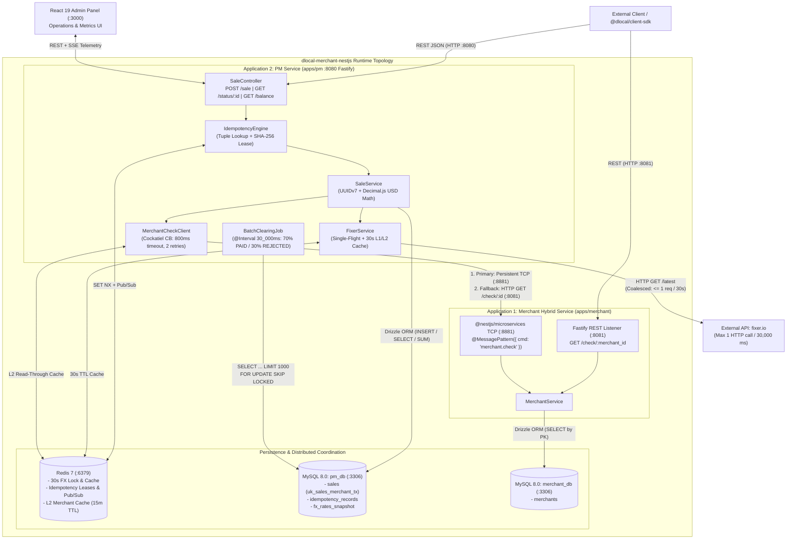

# System architecture overview

This document provides the executive summary, requirements traceability matrix, system topology diagram, and navigation index for the **Node.js 22 LTS + TypeScript v7 (`tsgo`) + NestJS 11** architecture designed to fulfill the 2018/05/17 specification in [docs/requirements.md](../requirements.md).

---

## 1. Executive summary

The `dlocal-merchant-nestjs` workspace translates the 2018/05/17 payment processing challenge (originally targeting Java 8, Spring 5, Embedded Jetty, Maven, and MySQL 5.x) into a `pnpm` monorepo powered by **Node.js 22 LTS**, **TypeScript v7 (`@typescript/native-preview` / `tsgo`)**, **NestJS 11 (`@nestjs/platform-fastify` + `@nestjs/microservices`)**, and **MySQL 8.0 (InnoDB) with Drizzle ORM**.

The architecture separates responsibilities across two decoupled applications and a scheduled clearing engine:
1. **Application 1 (`apps/merchant`):** Runs as a NestJS Hybrid Application exposing both an external Fastify HTTP REST endpoint (`GET /check/:merchant_id` on port `8081`, returning `200 OK` or `404 Not Found`) and an internal `@nestjs/microservices` TCP listener (`@MessagePattern({ cmd: 'merchant.check' })` on port `8881`) backed by `merchant_db.merchants`.
2. **Application 2 (`apps/pm`, Payment Manager):** Runs on Fastify (port `8080`) backed by `pm_db` and Redis 7. It exposes:
   - `POST /sale`: Validates `merchant_id` against `apps/merchant` (`800 ms` timeout budget), converts `amount` from the source currency to `USD` via `fixer.io` using `decimal.js` (`ROUND_HALF_UP`, scale 2) while enforcing **at most 1 outbound `fixer.io` request every 30 seconds** (`30,000 ms`), and persists the transaction in `PENDING` state with strict idempotency on `(merchant_id, transaction_id)`.
   - `GET /status/:id`: Queries transaction state (`id`, `date`, `transaction_id`, `merchant_id`, `amount_usd`, and `status`: `PENDING | PAID | REJECTED`).
   - `GET /balance?merchant_id={id}&from={date}&to={date}`: Executes a single index-only conditional aggregation scan over `idx_sales_merchant_date_status` to return `{ total_paid, total_pending, total_rejected }` in `USD`.
3. **30-Second Batch Clearing Engine (`BatchClearingJob`):** Executes every `30,000 ms` via `@nestjs/schedule`, selecting `PENDING` transactions in chunks of `1,000` rows with `SELECT ... FOR UPDATE SKIP LOCKED` and transitioning each transaction to `PAID` (`70%` probability) or `REJECTED` (`30%` probability).

---

## 2. Requirements traceability matrix

| Requirement (`docs/requirements.md`) | Target Service & Component | Enforcement Mechanism & Quantified Bounds |
| :--- | :--- | :--- |
| **Merchant `CHECK`** (`200 OK` if exists, `404 Not Found` otherwise) | `apps/merchant` (`MerchantController`, `MerchantService`) | `GET /check/:merchant_id` on `:8081` and `@MessagePattern({ cmd: 'merchant.check' })` on `:8881` querying `merchant_db.merchants` primary key. |
| **PM `SALE` USD persistence via `fixer.io`** | `apps/pm` (`SaleService`, `FixerService`) | Cross-rate calculation via `decimal.js` (`ROUND_HALF_UP`, scale 2) persisted in `sales.amount_usd` (`DECIMAL(18, 2)`). |
| **PM `SALE` idempotency on `(merchant_id, transaction_id)`** | `apps/pm` (`SaleService`, `IdempotencyEngine`, MySQL `uk_sales_merchant_tx`) | Unique index `uk_sales_merchant_tx (merchant_id, transaction_id)` with `ER_DUP_ENTRY` race recovery (Phase 1) + Redis `SET NX` / PubSub & RFC 8785 SHA-256 hash check (`HTTP 422` on payload mutation in Phase 2). |
| **Platform-unique autogenerated `id`** | `apps/pm` (`SaleService`) | RFC 9562 time-ordered **UUIDv7** generated on creation and returned identically on every duplicate `(merchant_id, transaction_id)` call. |
| **`fixer.io` queried at most once every 30 seconds** | `apps/pm` (`FixerService`) | In-process `inFlightPromise` single-flight coalescing + L1 memory cache (`30,000 ms` TTL) + L2 Redis lock/cache (`30,000 ms` TTL) + MySQL `fx_rates_snapshot` fallback. |
| **All sales start in `PENDING` status** | `apps/pm` (`SaleService`, `sales.status`) | `INSERT INTO sales` explicitly sets `status = 'PENDING'` (and column default is `'PENDING'`). |
| **Validate `merchant_id` against `CHECK` service** | `apps/pm` (`MerchantCheckClient`) -> `apps/merchant` | Synchronous RPC prior to sale insertion (`800 ms` timeout, max 2 retries with `100 ms` base backoff); aborts with `HTTP 404` if merchant does not exist. |
| **PM `STATUS` (`GET /status/{id}`)** | `apps/pm` (`SaleController.getStatus`) | Primary-key lookup on `sales.id`, returning `{ id, date, transaction_id, merchant_id, amount_usd, status }` or `HTTP 404`. |
| **PM `BALANCE` (`GET /balance?merchant_id=...&from=...&to=...`)** | `apps/pm` (`SaleController.getBalance`) | Single SQL `SUM(CASE WHEN status = ...)` query over covering index `idx_sales_merchant_date_status (merchant_id, created_at, status, amount_usd)`. |
| **30-Second Batch Job (`70% PAID / 30% REJECTED`)** | `apps/pm` (`BatchClearingJob`) | `@Interval(30_000)` chunked `SELECT ... LIMIT 1000 FOR UPDATE SKIP LOCKED` with injectable `RandomProvider` (`r < 0.70 -> PAID`, `r >= 0.70 -> REJECTED`). |
| **Automated tests & startup script** | `apps/*/test`, `start-apps.ps1`, `docker-compose.yml` | Vitest + Supertest unit, concurrency, and E2E suites; `start-apps.ps1` orchestrates MySQL 8.0, Redis 7, `apps/merchant`, and `apps/pm`. |

---

## 3. System topology diagram

---

## 4. Summary of architecture decision records (ADRs)

| ADR | Topic | Selected Decision | Reference |
| :--- | :--- | :--- | :--- |
| **ADR-01** | TypeScript v7 (`tsgo`), NestJS DI, Decimal Math & IDs | `@typescript/native-preview` (`tsgo`) for type-checking + `@swc/core` for compilation + explicit `@Inject()` Symbol tokens; `decimal.js` (`ROUND_HALF_UP`, scale 2); RFC 9562 UUIDv7. | [01-STACK-PORTING-AND-ADRS.md](./01-STACK-PORTING-AND-ADRS.md#adr-01-typescript-v7-tsgo-nestjs-di-configuration-decimal-math-and-id-generation) |
| **ADR-02** | HTTP Server & Hybrid App Strategy | `@nestjs/platform-fastify` across both services; `apps/merchant` runs as a NestJS Hybrid Application serving HTTP (`:8081`) and TCP (`:8881`). | [01-STACK-PORTING-AND-ADRS.md](./01-STACK-PORTING-AND-ADRS.md#adr-02-http-server-adapter-and-hybrid-application-strategy) |
| **ADR-03** | Inter-Service Communication (`PM <-> Merchant CHECK`) | `@nestjs/microservices` persistent `Transport.TCP` (`ClientProxy`) with HTTP fallback, wrapped in `cockatiel` (`800 ms` timeout, max 2 retries, L1/L2 cache). | [01-STACK-PORTING-AND-ADRS.md](./01-STACK-PORTING-AND-ADRS.md#adr-03-inter-service-communication-pm---merchant-check) |
| **ADR-04** | Database Engine & ORM / Query Builder | MySQL 8.0 (InnoDB) with Drizzle ORM (`drizzle-orm/mysql2`) and schema isolation (`merchant_db` vs `pm_db`). | [01-STACK-PORTING-AND-ADRS.md](./01-STACK-PORTING-AND-ADRS.md#adr-04-database-engine-orm--query-builder-and-schema-isolation) |
| **ADR-05** | `fixer.io` 30s Rate-Limit & Caching Strategy | Three-tier rate limiter: in-process `inFlightPromise` coalescing + L1 memory cache (`30,000 ms`) + L2 Redis lock/TTL (`30,000 ms`) + MySQL `fx_rates_snapshot`. | [01-STACK-PORTING-AND-ADRS.md](./01-STACK-PORTING-AND-ADRS.md#adr-05-fixerio-30-second-rate-limit-and-caching-strategy) |
| **ADR-06** | 30-Second Batch Clearing Engine | `@nestjs/schedule` `@Interval(30_000)` executing chunked `SELECT ... LIMIT 1000 FOR UPDATE SKIP LOCKED` updates with an injectable `RandomProvider`. | [01-STACK-PORTING-AND-ADRS.md](./01-STACK-PORTING-AND-ADRS.md#adr-06-30-second-batch-clearing-engine) |

---

## 5. Architecture documentation index

| Document | Scope & Contents |
| :--- | :--- |
| **[../requirements.md](../requirements.md)** | Baseline 2018/05/17 technical specification (`Merchant`, `PM`, `Batch Process`, `Tests`, and deliverables). |
| **[00-OVERVIEW.md](./00-OVERVIEW.md)** | Executive summary, requirements traceability matrix, system topology diagram, and navigation index. |
| **[01-STACK-PORTING-AND-ADRS.md](./01-STACK-PORTING-AND-ADRS.md)** | Part-by-part stack porting matrix (`Java 8 / Spring 5` to `Node.js 22 / TypeScript v7 tsgo / NestJS 11`) and `ADR-01` through `ADR-06`. |
| **[02-SYSTEM-INTEGRATION-AND-FLOWS.md](./02-SYSTEM-INTEGRATION-AND-FLOWS.md)** | End-to-end component interactions and Mermaid sequence diagrams for Flows 1 through 5 (`SALE` & `CHECK`, concurrent idempotency, 30s `fixer.io` rate limiting, `STATUS` & `BALANCE`, and 30s batch clearing). |
| **[03-DATA-MODEL-AND-CONTRACTS.md](./03-DATA-MODEL-AND-CONTRACTS.md)** | MySQL 8.0 DDL, Drizzle ORM TypeScript schemas, index justification, REST API contracts, and `@nestjs/microservices` RPC contracts. |
| **[04-IMPLEMENTATION-AND-TEST-PLAN.md](./04-IMPLEMENTATION-AND-TEST-PLAN.md)** | Monorepo folder structure, `tsconfig.base.json` (`tsgo`), `docker-compose.yml` & `start-apps.ps1` orchestration, unit/concurrency/E2E test plan, and Phase 2+ extensions roadmap. |
