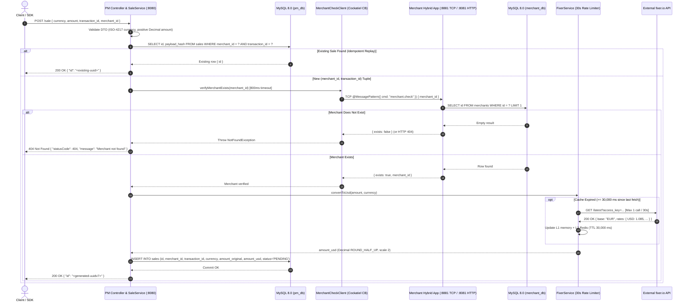
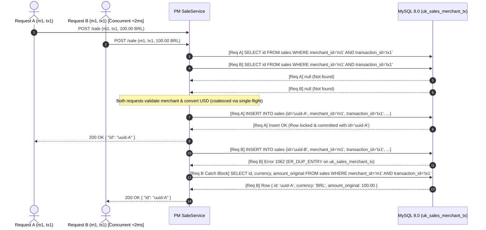
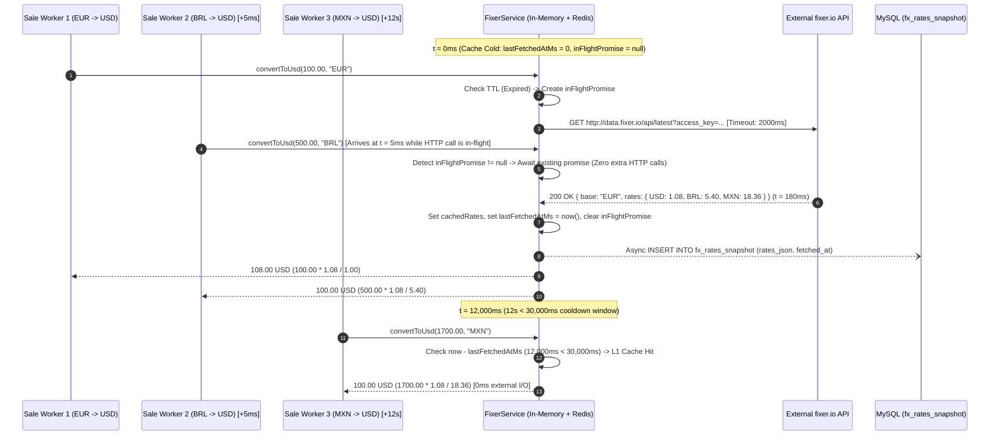
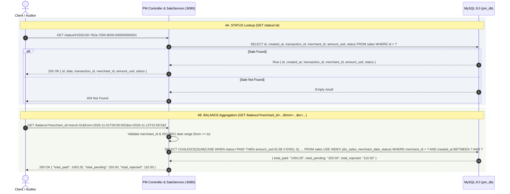
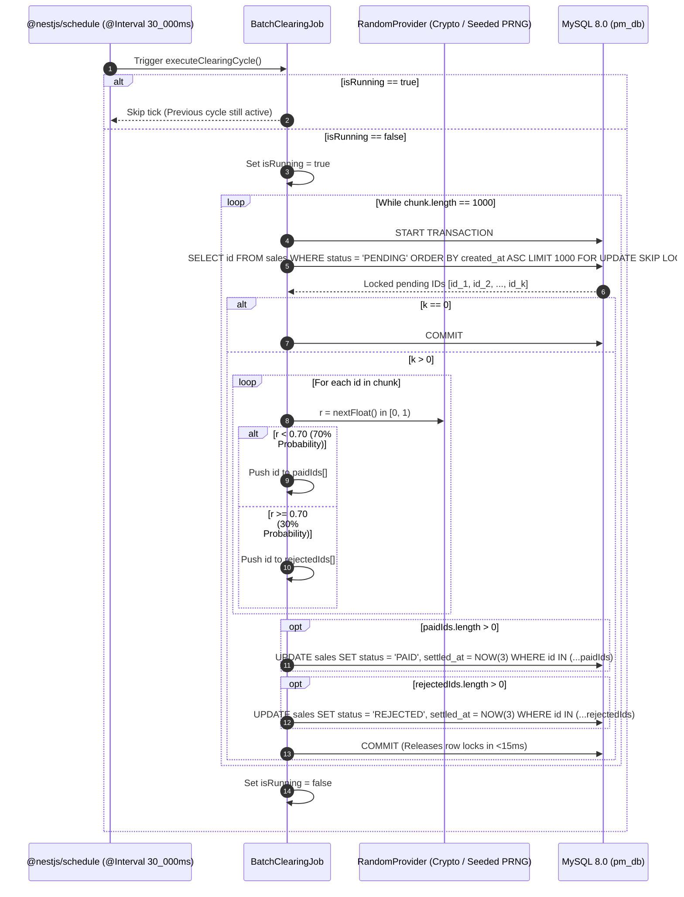

# System integration and end-to-end flows

This document details how `apps/merchant`, `apps/pm`, MySQL 8.0, Redis 7, and `fixer.io` interact across all five operational flows defined by [docs/requirements.md](../requirements.md) and the decisions in [01-STACK-PORTING-AND-ADRS.md](./01-STACK-PORTING-AND-ADRS.md).

---

## 1. Flow 1: `SALE` and inter-service `CHECK`

When a client submits `POST /sale`, `apps/pm` validates the payload, checks for an existing idempotent record on `(merchant_id, transaction_id)`, verifies `merchant_id` against `apps/merchant` via `@nestjs/microservices` TCP RPC (or HTTP REST fallback), converts `amount` to `USD` via `FixerService`, and inserts the transaction in `PENDING` state.

### Execution sequence and invariants
1. **DTO validation (`ValidationPipe`):** Rejects malformed requests (`HTTP 400 Bad Request`) before any database or network call occurs.
2. **Idempotency short-circuit:** Queries `uk_sales_merchant_tx (merchant_id, transaction_id)` first. If a committed transaction already exists for that tuple, `PM` returns `{ "id": existing.id }` immediately without calling `apps/merchant` or `fixer.io`.
3. **Inter-service `CHECK`:** Dispatches `{ cmd: 'merchant.check' }` over the persistent TCP socket to `apps/merchant:8881` (or `GET /check/:merchant_id` on `:8081` when `MERCHANT_TRANSPORT=http`). If the merchant is missing, `PM` aborts before currency conversion or database insertion and returns `HTTP 404 Not Found`.
4. **USD normalization:** Converts `amount` from `currency` to `USD` using `decimal.js` (`ROUND_HALF_UP`, scale 2).
5. **Initial state:** Persists the row with `status = 'PENDING'` and returns `{ "id": "<uuidv7>" }`.

---

## 2. Flow 2: Idempotency and concurrency resolution

The specification requires `POST /sale` to return the exact same autogenerated `id` when invoked multiple times with the same `(merchant_id, transaction_id)`. Under concurrent bursts (such as a double-click or immediate network retry within `0 ms` to `20 ms`), two identical requests can pass the initial `SELECT` check simultaneously before either executes `INSERT`.

### 2.1 Phase 1 baseline concurrency resolution (MySQL unique constraint recovery)

### 2.2 Phase 2+ distributed lease and payload fingerprint verification
To eliminate wasted downstream `CHECK` calls during in-flight races and detect accidental payload mutation on retries, Phase 2 wraps `POST /sale` in the `IdempotencyEngine`:
1. **Canonical fingerprint:** Computes `sha256(RFC8785({ merchant_id, transaction_id, currency, amount }))`.
2. **Atomic lease acquisition:** Executes `SET idemp:m1:tx1 <lease_json> NX PX 30000` in Redis (backed by `idempotency_records` in MySQL).
3. **In-flight wait (`Pub/Sub`):** If a concurrent duplicate request sees `status = 'IN_FLIGHT'` with a matching SHA-256 hash, it subscribes to `idemp:done:m1:tx1` for up to `1,500 ms`. When Request A commits `uuid-A`, Request B wakes up in `<2 ms` and returns `{ "id": "uuid-A" }`. If Request A is still running after `1,500 ms`, Request B returns `HTTP 409 Conflict` with `Retry-After: 1`.
4. **Payload mutation guard (`HTTP 422`):** If a caller reuses `(merchant_id: "m1", transaction_id: "tx1")` with a different `amount` or `currency`, the SHA-256 comparison fails and `PM` returns `HTTP 422 Unprocessable Entity`.

---

## 3. Flow 3: `fixer.io` rate-limited currency conversion

`FixerService` guarantees that external HTTP requests to `fixer.io` never exceed **1 call per 30,000 ms**, even when hundreds of concurrent `POST /sale` requests arrive during a cache miss.

### Rate-limit enforcement rules
1. **30-second invariant:** Let $T_1, T_2, \dots, T_k$ be the timestamps of outbound HTTP requests emitted to `fixer.io`. For every $i \ge 1$, $T_{i+1} - T_i \ge 30,000\text{ ms}$.
2. **Cross-rate precision:** Using `decimal.js`, for any source currency $C$:
   $$\text{rate\_to\_usd} = \frac{\text{Decimal}(\text{rates}[\text{'USD'}])}{\text{Decimal}(\text{rates}[C])}$$
   $$\text{amount\_usd} = \text{Decimal}(\text{amount}).\text{mul}(\text{rate\_to\_usd}).\text{toDecimalPlaces}(2, \text{Decimal.ROUND\_HALF\_UP})$$
3. **Unsupported currency handling:** If `rates[currency]` is undefined in the `fixer.io` table, `FixerService` throws `BadRequestException` (`HTTP 400 Bad Request: Unsupported currency code`).

---

## 4. Flow 4: `STATUS` and `BALANCE` queries

`GET /status/:id` performs a single primary-key lookup, while `GET /balance` executes a single index-backed conditional aggregation query over `(merchant_id, created_at, status, amount_usd)`.

### Query optimization details
- **Covering index scan for `BALANCE`:** The composite index `idx_sales_merchant_date_status (merchant_id, created_at, status, amount_usd)` includes `amount_usd` as the trailing column. MySQL 8.0 satisfies the entire `GET /balance` `SUM` query via an index-only range scan (`Using index`) without touching InnoDB data pages.
- **Zero-row merchant behavior:** `COALESCE(SUM(...), 0.00)` guarantees that if a merchant has zero transactions in the `[from, to]` window, the endpoint returns `{ "total_paid": 0.00, "total_pending": 0.00, "total_rejected": 0.00 }` with `HTTP 200 OK`.

---

## 5. Flow 5: 30-second batch clearing lifecycle

Every `30,000 ms`, `BatchClearingJob` sweeps all `PENDING` transactions and transitions each one to `PAID` (70% probability) or `REJECTED` (30% probability) while concurrent `POST /sale`, `GET /status/:id`, and `GET /balance` requests continue executing.

### Concurrency coexistence guarantees
1. **Non-blocking `POST /sale` inserts:** Because `SELECT ... FOR UPDATE SKIP LOCKED` uses the secondary index `idx_sales_status_created (status, created_at)` and commits in chunks of `1,000` rows (`<15 ms` per transaction), incoming `POST /sale` inserts do not wait on table-wide locks.
2. **Consistent `GET /balance` and `GET /status/:id` reads:** Under MySQL 8.0 default `REPEATABLE READ` (or `READ COMMITTED`), `SELECT` queries use Multi-Version Concurrency Control (MVCC) non-locking reads. They never block on `FOR UPDATE` locks held by `BatchClearingJob` and always observe committed point-in-time snapshots.
3. **Multi-replica safety:** If two `apps/pm` instances run `@Interval(30_000)` concurrently, `SKIP LOCKED` ensures Instance B skips the 1,000 `PENDING` rows locked by Instance A and immediately grabs the next 1,000 `PENDING` rows.
