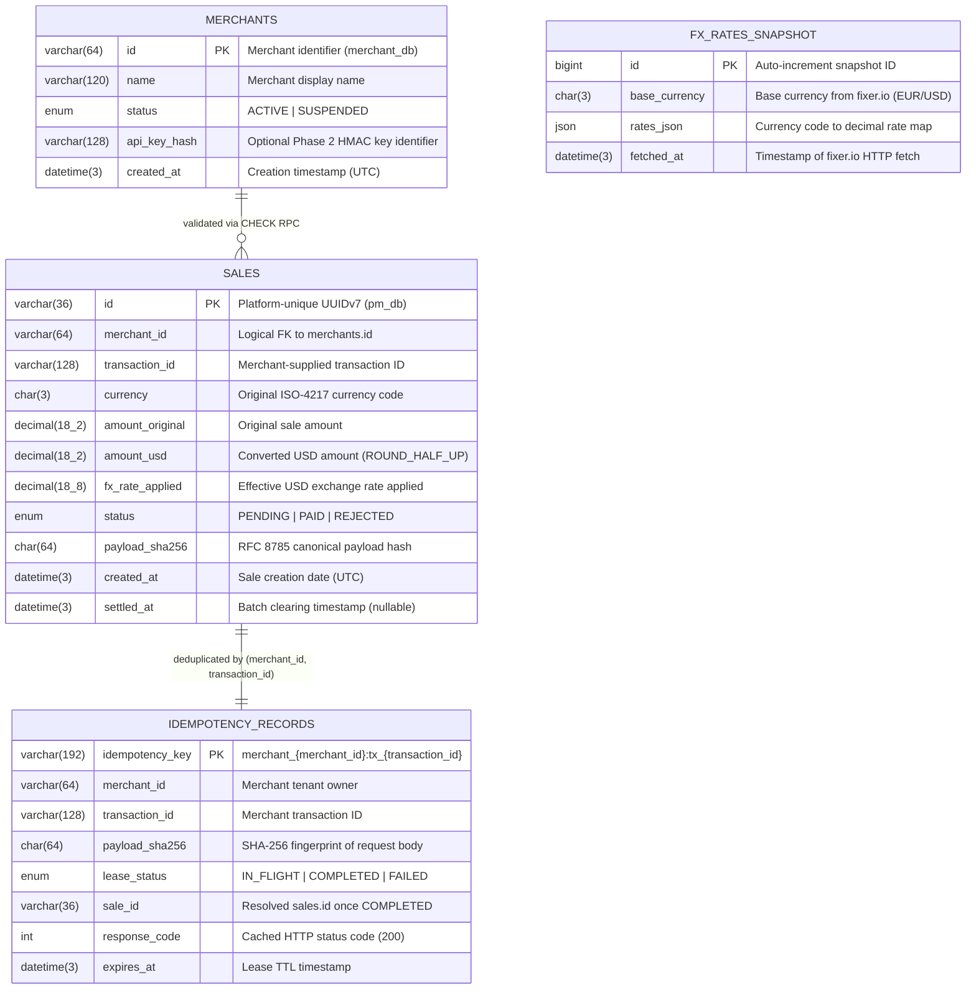

# Data model, database schema, and service contracts

This document defines the MySQL 8.0 relational schemas, Drizzle ORM definitions, index designs, REST HTTP contracts, and internal `@nestjs/microservices` message contracts for `apps/merchant` and `apps/pm`.

---

## 1. Entity-relationship overview



---

## 2. MySQL 8.0 DDL and indexing strategy

### 2.1 Database 1: `merchant_db` (Owned by `apps/merchant`)

```sql
CREATE DATABASE IF NOT EXISTS merchant_db
  CHARACTER SET utf8mb4
  COLLATE utf8mb4_0900_ai_ci;

USE merchant_db;

CREATE TABLE merchants (
  id VARCHAR(64) NOT NULL,
  name VARCHAR(120) NOT NULL,
  status ENUM('ACTIVE', 'SUSPENDED') NOT NULL DEFAULT 'ACTIVE',
  api_secret_encrypted VARCHAR(255) NULL,
  created_at DATETIME(3) NOT NULL DEFAULT CURRENT_TIMESTAMP(3),
  PRIMARY KEY (id)
) ENGINE=InnoDB DEFAULT CHARSET=utf8mb4 COLLATE=utf8mb4_0900_ai_ci;
```

### 2.2 Database 2: `pm_db` (Owned by `apps/pm`)

```sql
CREATE DATABASE IF NOT EXISTS pm_db
  CHARACTER SET utf8mb4
  COLLATE utf8mb4_0900_ai_ci;

USE pm_db;

CREATE TABLE sales (
  id VARCHAR(36) NOT NULL,
  merchant_id VARCHAR(64) NOT NULL,
  transaction_id VARCHAR(128) NOT NULL,
  currency CHAR(3) NOT NULL,
  amount_original DECIMAL(18, 2) NOT NULL,
  amount_usd DECIMAL(18, 2) NOT NULL,
  fx_rate_applied DECIMAL(18, 8) NOT NULL DEFAULT 1.00000000,
  status ENUM('PENDING', 'PAID', 'REJECTED') NOT NULL DEFAULT 'PENDING',
  payload_sha256 CHAR(64) NULL,
  created_at DATETIME(3) NOT NULL DEFAULT CURRENT_TIMESTAMP(3),
  settled_at DATETIME(3) NULL,
  PRIMARY KEY (id),
  -- Enforces strict idempotency on the (merchant_id, transaction_id) tuple:
  UNIQUE KEY uk_sales_merchant_tx (merchant_id, transaction_id),
  -- Covering index for GET /balance?merchant_id=...&from=...&to=... (index-only scan):
  KEY idx_sales_merchant_date_status (merchant_id, created_at, status, amount_usd),
  -- Supports 30s batch clearing SELECT ... WHERE status = 'PENDING' ORDER BY created_at LIMIT 1000:
  KEY idx_sales_status_created (status, created_at)
) ENGINE=InnoDB DEFAULT CHARSET=utf8mb4 COLLATE=utf8mb4_0900_ai_ci;

CREATE TABLE fx_rates_snapshot (
  id BIGINT UNSIGNED NOT NULL AUTO_INCREMENT,
  base_currency CHAR(3) NOT NULL DEFAULT 'EUR',
  rates_json JSON NOT NULL,
  fetched_at DATETIME(3) NOT NULL DEFAULT CURRENT_TIMESTAMP(3),
  PRIMARY KEY (id),
  KEY idx_fx_fetched_at (fetched_at DESC)
) ENGINE=InnoDB DEFAULT CHARSET=utf8mb4 COLLATE=utf8mb4_0900_ai_ci;

CREATE TABLE idempotency_records (
  idempotency_key VARCHAR(192) NOT NULL,
  merchant_id VARCHAR(64) NOT NULL,
  transaction_id VARCHAR(128) NOT NULL,
  payload_sha256 CHAR(64) NOT NULL,
  lease_status ENUM('IN_FLIGHT', 'COMPLETED', 'FAILED') NOT NULL DEFAULT 'IN_FLIGHT',
  sale_id VARCHAR(36) NULL,
  created_at DATETIME(3) NOT NULL DEFAULT CURRENT_TIMESTAMP(3),
  expires_at DATETIME(3) NOT NULL,
  PRIMARY KEY (idempotency_key),
  KEY idx_idemp_expires (expires_at)
) ENGINE=InnoDB DEFAULT CHARSET=utf8mb4 COLLATE=utf8mb4_0900_ai_ci;
```

### 2.3 Index justification table

| Index Name | Table | Columns | Target Query & Access Pattern |
| :--- | :--- | :--- | :--- |
| `PRIMARY` (`id`) | `merchants` | `(id)` | `GET /check/:merchant_id`: clustered primary-key point lookup (`O(log N)`, `<0.2 ms`). |
| `PRIMARY` (`id`) | `sales` | `(id)` | `GET /status/:id`: clustered primary-key point lookup; UUIDv7 time-prefix prevents B+ Tree random page splits during `INSERT`. |
| `uk_sales_merchant_tx` | `sales` | `(merchant_id, transaction_id)` | `POST /sale`: enforces uniqueness and serves point lookups for existing `(merchant_id, transaction_id)` pairs in `<0.3 ms`. |
| `idx_sales_merchant_date_status` | `sales` | `(merchant_id, created_at, status, amount_usd)` | `GET /balance`: filters by `merchant_id = ?` and `created_at BETWEEN ? AND ?`, then sums `amount_usd` grouped by `status` directly from the index leaf pages without table heap lookups. |
| `idx_sales_status_created` | `sales` | `(status, created_at)` | `BatchClearingJob`: scans only `status = 'PENDING'` rows ordered by `created_at ASC` for chunked `FOR UPDATE SKIP LOCKED` updates. |

---

## 3. Drizzle ORM schema definitions (`TypeScript v7 / tsgo`)

```typescript
// apps/pm/src/db/schema.ts
import {
  mysqlTable,
  varchar,
  char,
  decimal,
  mysqlEnum,
  datetime,
  uniqueIndex,
  index,
} from 'drizzle-orm/mysql-core';

export const sales = mysqlTable(
  'sales',
  {
    id: varchar('id', { length: 36 }).primaryKey().notNull(),
    merchantId: varchar('merchant_id', { length: 64 }).notNull(),
    transactionId: varchar('transaction_id', { length: 128 }).notNull(),
    currency: char('currency', { length: 3 }).notNull(),
    amountOriginal: decimal('amount_original', { precision: 18, scale: 2 }).notNull(),
    amountUsd: decimal('amount_usd', { precision: 18, scale: 2 }).notNull(),
    fxRateApplied: decimal('fx_rate_applied', { precision: 18, scale: 8 })
      .notNull()
      .default('1.00000000'),
    status: mysqlEnum('status', ['PENDING', 'PAID', 'REJECTED'])
      .notNull()
      .default('PENDING'),
    payloadSha256: char('payload_sha256', { length: 64 }),
    createdAt: datetime('created_at', { mode: 'date', fsp: 3 }).notNull(),
    settledAt: datetime('settled_at', { mode: 'date', fsp: 3 }),
  },
  (table) => [
    uniqueIndex('uk_sales_merchant_tx').on(table.merchantId, table.transactionId),
    index('idx_sales_merchant_date_status').on(
      table.merchantId,
      table.createdAt,
      table.status,
      table.amountUsd,
    ),
    index('idx_sales_status_created').on(table.status, table.createdAt),
  ],
);
```

---

## 4. External REST API contracts

### 4.1 Application 1 (`Merchant`, Port `8081`)

#### `GET /check/:merchant_id`
Checks whether `merchant_id` exists in `merchant_db.merchants`.

- **Path parameters:**
  - `merchant_id` (`string`, required, 1 to 64 characters).
- **Responses:**
  - **`200 OK`** (Merchant exists and is active):
    ```json
    {
      "merchant_id": "merch-01",
      "status": "ACTIVE"
    }
    ```
  - **`404 Not Found`** (Merchant does not exist):
    ```json
    {
      "statusCode": 404,
      "error": "Not Found",
      "message": "Merchant merch-999 not found"
    }
    ```

---

### 4.2 Application 2 (`PM`, Port `8080`)

#### 1. `POST /sale`
Registers a sale in `USD`, enforcing `(merchant_id, transaction_id)` idempotency, Merchant `CHECK` validation, and the 30-second `fixer.io` rate limit.

- **Request headers:**
  - `Content-Type: application/json` (required)
  - `Idempotency-Key: <string>` (optional Phase 2 override; defaults to `merchant_${merchant_id}:tx_${transaction_id}`)
  - `X-Merchant-Key`, `X-Timestamp`, `X-Signature` (optional when `AUTH_MODE=optional`, required when `AUTH_MODE=strict` in Phase 2)
- **Request body (`CreateSaleDto`):**
  ```json
  {
    "currency": "BRL",
    "amount": 250.00,
    "transaction_id": "tx-2026-0001",
    "merchant_id": "merch-01"
  }
  ```
  - `currency`: 3-letter uppercase ISO-4217 code (`^[A-Z]{3}$`).
  - `amount`: Positive decimal number or numeric string (`> 0`, maximum 2 decimal places).
  - `transaction_id`: Non-empty string (`1..128` chars).
  - `merchant_id`: Non-empty string (`1..64` chars).
- **Responses:**
  - **`200 OK`** (New sale created in `PENDING` status, or idempotent replay of existing `(merchant_id, transaction_id)`):
    ```json
    {
      "id": "01932c50-7b2a-7000-8000-000000000001"
    }
    ```
  - **`400 Bad Request`** (Invalid DTO fields, negative/zero amount, or unsupported currency code).
  - **`404 Not Found`** (`merchant_id` returned `404` from the Merchant `CHECK` service).
  - **`409 Conflict`** (Phase 2: concurrent duplicate request still in-flight after `1,500 ms` wait window; includes `Retry-After: 1` header).
  - **`422 Unprocessable Entity`** (Phase 2: duplicate `(merchant_id, transaction_id)` sent with mutated `amount` or `currency`).
  - **`503 Service Unavailable`** (Downstream Merchant service or `fixer.io` unreachable with no cached fallback available).

---

#### 2. `GET /status/:id`
Queries the state of a transaction by the platform-unique `id` returned by `POST /sale`.

- **Path parameters:**
  - `id` (`string`, required, UUID returned by `POST /sale`).
- **Responses:**
  - **`200 OK`**:
    ```json
    {
      "id": "01932c50-7b2a-7000-8000-000000000001",
      "date": "2026-11-13T04:00:00.000Z",
      "transaction_id": "tx-2026-0001",
      "merchant_id": "merch-01",
      "amount_usd": 46.30,
      "status": "PENDING"
    }
    ```
    - `status`: `"PAID" | "PENDING" | "REJECTED"`.
    - `date`: ISO-8601 UTC creation timestamp (`sales.created_at`).
    - `amount_usd`: Decimal serialized as JSON number (or string when `DECIMAL_SERIALIZATION=string` is set; default matches numeric decimal representation with 2 fractional digits).
  - **`404 Not Found`** (`id` does not exist in `sales`).

---

#### 3. `GET /balance`
Returns accumulated USD amounts across `PAID`, `PENDING`, and `REJECTED` statuses for a merchant and date range.

- **Query parameters (`GetBalanceQueryDto`):**
  - `merchant_id` (`string`, required): Target merchant identifier.
  - `from` (`string`, required): Start date/timestamp (accepts ISO-8601 `YYYY-MM-DD` or `YYYY-MM-DDTHH:mm:ss.sssZ`). When a date-only string `YYYY-MM-DD` is provided, normalizes to `YYYY-MM-DDT00:00:00.000Z`.
  - `to` (`string`, required): End date/timestamp (`>= from`). When a date-only string `YYYY-MM-DD` is provided, normalizes to `YYYY-MM-DDT23:59:59.999Z`.
- **Example request:**
  ```text
  GET /balance?merchant_id=merch-01&from=2026-11-01T00:00:00Z&to=2026-11-13T23:59:59Z
  ```
- **Responses:**
  - **`200 OK`**:
    ```json
    {
      "total_paid": 1450.25,
      "total_pending": 320.00,
      "total_rejected": 110.50
    }
    ```
  - **`400 Bad Request`** (Missing `merchant_id`, invalid date format, or `from > to`).

---

## 5. Internal microservice message contracts (`@nestjs/microservices`)

Shared TypeScript interfaces live in `packages/shared-contracts/src/index.ts` and are imported by both `apps/merchant` and `apps/pm`.

```typescript
// packages/shared-contracts/src/merchant-rpc.contract.ts
export const MERCHANT_CHECK_PATTERN = { cmd: 'merchant.check' } as const;

export interface MerchantCheckRequest {
  readonly merchant_id: string;
  readonly trace_id?: string;
}

export interface MerchantCheckResponse {
  readonly exists: boolean;
  readonly merchant_id: string;
  readonly status?: 'ACTIVE' | 'SUSPENDED';
}
```

### Transport and timeout specification
- **Transport:** `Transport.TCP` (`host: MERCHANT_TCP_HOST`, `port: 8881`).
- **Timeout & retry budget:** `PM` wraps `this.merchantClient.send<MerchantCheckResponse, MerchantCheckRequest>(MERCHANT_CHECK_PATTERN, payload)` with RxJS `firstValueFrom(stream.pipe(timeout(800)))` inside the `cockatiel` resiliency policy (`800 ms` timeout, max 2 retries with `100 ms` base backoff).
- **Error mapping:** Because `exists: false` is returned as a structured response payload (`{ exists: false, merchant_id }`) over TCP rather than an unhandled transport exception, `PM` distinguishes between a business `404 Not Found` (`exists === false`) and a transport/network failure (`RpcException` or socket timeout).
